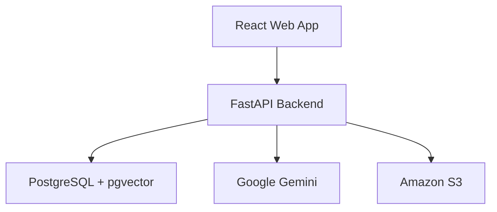
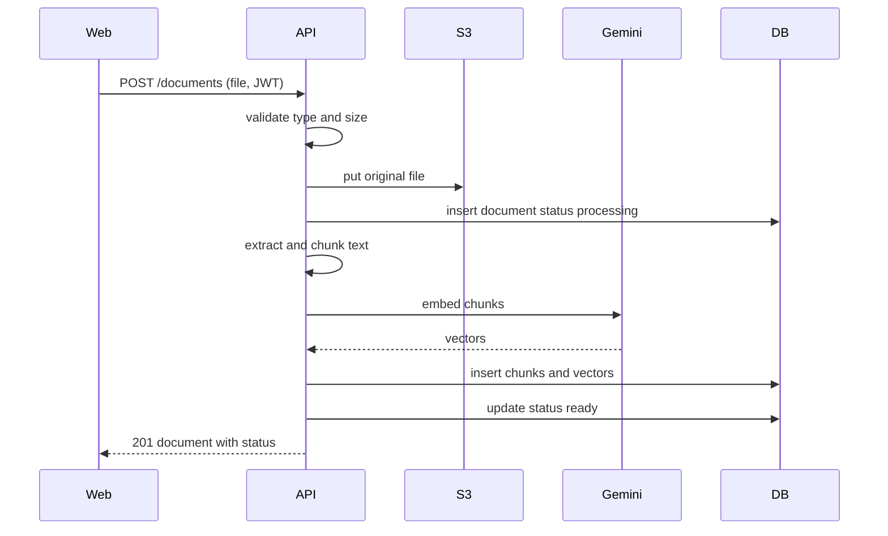
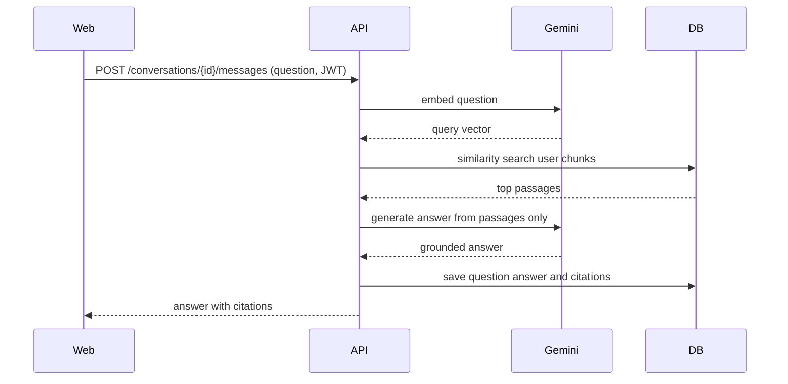
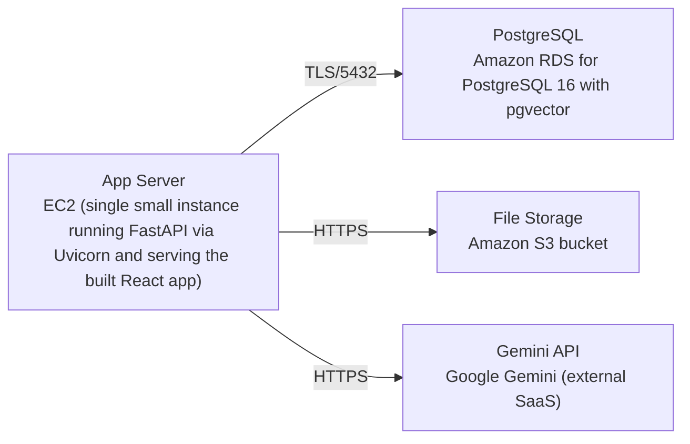

# Architecture

> Maintained by QuorQ AI SDLC. Text between `sdlc:auto` markers is regenerated; anything outside them is yours and is kept.

<!-- sdlc:auto:start narrative -->
## Overview

### ARCH-SUMMARY · approved · source: architecture:summary

Lightweight per-user RAG chat prototype: React 19 UI for signup/login, document upload, and citation-grounded chat; FastAPI backend handling auth, storage, chunking, embeddings, retrieval and per-user isolation; single PostgreSQL+pgvector store; Gemini for embeddings/generation; S3 for original files. Runs on one small AWS instance, sized for a handful of users as an accepted risk.

Architecture v1, status approved. The system lets users self-register, log in, upload PDF/DOCX/TXT/Markdown files, and chat with answers grounded strictly in their own documents with citations. FastAPI hashes passwords, stores original files in S3, extracts/chunks document text, calls Google Gemini for embeddings and answer generation, and reads/writes PostgreSQL 16 with pgvector holding users, documents, chunks+embeddings, conversations and messages in one database. Per-user isolation is enforced on every query. Deployment is a single small AWS instance with managed RDS Postgres and S3, explicitly sized for a handful of users as an accepted risk (not a scaling target).

- ⚠ No requirements-phase document was supplied with this input, so this summary cannot be cross-checked against or explicitly linked to requirement IDs US-001..US-011.
- ⚠ Single-instance sizing is called out as an accepted risk but no capacity numbers, SLA, or scale-up plan are given.

### ARCH-COMP-WEB · approved · source: architecture:web

React 19 responsive browser app providing signup/login, document upload and library, and the chat screen with citations.

Component 'web' - React Web App (React 19). Holds the session token client-side and redirects unauthenticated users to the login screen. Provides the UI surfaces for: signup/login, document upload and library view, and an interactive chat screen that displays citations alongside answers.

**Related:** ARCH-API-AUTH, ARCH-API-DOCUMENTS, ARCH-API-CONVERSATIONS

- ⚠ Exact screen inventory/navigation structure is not itemized here, only the three functional areas (auth, documents, chat).

### ARCH-COMP-API · approved · source: architecture:api

FastAPI 0.115 backend handling authentication, file upload to S3, document extraction/chunking, Gemini calls, pgvector retrieval, and per-user-scoped persistence.

Component 'api' - FastAPI Backend (FastAPI 0.115). Responsibilities: user registration/login with JWT sessions, file upload to S3, document text extraction and chunking, Gemini embedding and answer-generation calls, retrieval over pgvector, and persistence of all data scoped per user.

**Related:** ARCH-COMP-DB, ARCH-COMP-GEMINI, ARCH-COMP-S3, ARCH-CP-UPLOAD, ARCH-CP-CHAT

### ARCH-COMP-DB · approved · source: architecture:db

Single PostgreSQL 16 + pgvector store holding users, documents, chunks with embeddings, conversations, messages and citations; pgvector powers similarity search for retrieval.

Component 'db' - PostgreSQL + pgvector (PostgreSQL 16). One store for all relational and vector data: users, documents, text chunks with embedding vectors, conversations, messages and citations. pgvector extension provides similarity search used during retrieval.

**Related:** ARCH-DATA-MODEL

### ARCH-COMP-GEMINI · approved · source: architecture:gemini

Google Gemini (hosted SaaS) supplies chunk embeddings and grounded answer generation from retrieved passages.

Component 'gemini' - Google Gemini (Google Gemini (SaaS)). Used for two functions: embedding document chunks at upload time, and generating grounded answers from retrieved passages at chat time.

**Related:** ARCH-CP-UPLOAD, ARCH-CP-CHAT

- ⚠ Specific Gemini model name/version is not specified in the architecture input.

### ARCH-COMP-S3 · approved · source: architecture:s3

Amazon S3 durably stores original uploaded files, keyed per user and document, outside the database.

Component 's3' - Amazon S3 (Amazon S3). Holds the original uploaded files (as opposed to extracted text/embeddings, which live in Postgres), keyed per user and document.

**Related:** ARCH-CP-UPLOAD

### ARCH-CP-UPLOAD · approved · source: architecture:critical_path:document_upload_chunk_embed

Critical path: a logged-in user uploads a supported file; it is validated, stored in S3, text-extracted, chunked, embedded via Gemini, and written to pgvector, ending in ready or failed status.

A logged-in user uploads a supported file (PDF/DOCX/TXT/Markdown). Backend validates type and size, stores the original in S3, extracts text, splits it into chunks, embeds each chunk with Gemini, and writes chunks+vectors to pgvector. Document status moves from processing to ready, or to failed with a recorded reason if extraction or embedding fails (explicitly including the case of a missing Gemini key).

**Related:** ARCH-COMP-WEB, ARCH-COMP-API, ARCH-COMP-S3, ARCH-COMP-GEMINI, ARCH-COMP-DB, ARCH-API-DOCUMENTS

- ⚠ Specific chunk size/overlap strategy and accepted file size limits are not specified.

### ARCH-CP-CHAT · approved · source: architecture:critical_path:grounded_chat_with_citations

Critical path: a user's question is embedded, matched against their own chunks via pgvector similarity search, and answered by Gemini using only retrieved passages, with citations saved and returned.

A user sends a question in a conversation. Backend embeds the question with Gemini, runs a pgvector similarity search scoped to that user's own chunks, passes the top passages to Gemini with a grounded prompt, saves the question, answer and citations, and returns the answer with source document and passage references. If no passages are relevant, the system states it cannot find the answer rather than inventing one.

**Related:** ARCH-COMP-WEB, ARCH-COMP-API, ARCH-COMP-DB, ARCH-COMP-GEMINI, ARCH-API-CONVERSATIONS

- ⚠ Number of top passages retrieved (top-k) and the similarity threshold used to decide 'no relevant passages' are not specified.

### ARCH-DATA-MODEL · approved · source: architecture:entities

Six entities in PostgreSQL: users, documents, chunks, conversations, messages, citations, forming the full per-user RAG data model.

Entities:
- users: id, email, password_hash, created_at.
- documents: id, user_id, filename, content_type, size_bytes, s3_key, status, failure_reason, created_at.
- chunks: id, document_id, user_id, chunk_index, content, embedding, created_at.
- conversations: id, user_id, title, created_at.
- messages: id, conversation_id, role, content, created_at.
- citations: id, message_id, chunk_id, document_id.
All user-owned tables carry user_id (directly or via document_id/conversation_id) enabling per-user query scoping.

**Related:** ARCH-COMP-DB

### ARCH-API-AUTH · approved · source: architecture:endpoints:auth

Three auth endpoints: self-registration, login with JWT issuance, and logout.

- POST /auth/register: self-register with email and password; rejects duplicate email, invalid format, or weak password; stores only a password hash.
- POST /auth/login: authenticates and issues a JWT session; returns a generic error on bad credentials without revealing which field was wrong.
- POST /auth/logout: ends the current session (client discards token; server may blocklist if configured).

**Related:** ARCH-COMP-API, ARCH-COMP-WEB

- ⚠ Whether server-side token blocklisting is actually enabled, and JWT expiry duration, are not specified ('if configured').

### ARCH-API-DOCUMENTS · approved · source: architecture:endpoints:documents

Three document endpoints: upload, list, and delete, all scoped to the current user.

- POST /documents: upload a PDF/DOCX/TXT/Markdown file; validates type and size, stores in S3, triggers inline chunk+embed, returns the document with status.
- GET /documents: lists the current user's documents with name, upload date and processing status; returns an empty list when none exist.
- DELETE /documents/{id}: deletes one of the user's documents, removing the S3 object and its chunks/embeddings so it is no longer used or cited.

**Related:** ARCH-COMP-API, ARCH-COMP-S3, ARCH-COMP-DB, ARCH-CP-UPLOAD

### ARCH-API-CONVERSATIONS · approved · source: architecture:endpoints:conversations

Four conversation/message endpoints: list conversations, create a conversation, fetch a conversation's messages with citations, and send a new question.

- GET /conversations: lists the current user's saved conversations.
- POST /conversations: creates a new conversation for the user.
- GET /conversations/{id}/messages: returns the messages of a past conversation with their original citations; only the owner's conversations are accessible.
- POST /conversations/{id}/messages: sends a question; retrieves the user's relevant passages, generates a grounded Gemini answer, saves it with citations; states it cannot find the answer when no passages match, or prompts the user to upload when they have no processed documents.

**Related:** ARCH-COMP-API, ARCH-COMP-DB, ARCH-COMP-GEMINI, ARCH-CP-CHAT

### ARCH-DEPLOYMENT · approved · source: architecture:deployment_nodes

Single small EC2 instance runs FastAPI (Uvicorn) and serves the built React app; managed RDS Postgres 16 with pgvector; S3 bucket; external Gemini API.

Deployment nodes:
- App Server: EC2, single small instance running FastAPI via Uvicorn and serving the built React app; runtime Python 3.12 / Node build artifacts.
- PostgreSQL: Amazon RDS for PostgreSQL 16 with pgvector (managed).
- File Storage: Amazon S3 bucket (managed).
- Gemini API: Google Gemini, external SaaS (managed).

**Related:** ARCH-COMP-WEB, ARCH-COMP-API, ARCH-COMP-DB, ARCH-COMP-S3, ARCH-COMP-GEMINI

- ⚠ No instance sizing/type, autoscaling, backup, or networking/security-group details are given beyond 'single small instance' and 'managed'.

### ARCH-TECH-STACK · approved · source: architecture:technology_decisions

Technology choices: React 19 frontend, FastAPI 0.115 backend, PostgreSQL 16 + pgvector database, AWS cloud, each chosen for prototype speed over alternatives.

- Frontend: React 19 (alternatives considered: Vue, Svelte). Rationale: component model and ecosystem let the stateful chat UI with citations and file upload be assembled quickly for this prototype.
- Backend: FastAPI 0.115 (alternatives: Django REST Framework, Flask). Rationale: fastest path to a RAG prototype leveraging Python's document-parsing and AI client libraries, calling Gemini and reading/writing Postgres with pgvector.
- Database: PostgreSQL 16 with pgvector (alternatives: dedicated vector DB such as Pinecone/Qdrant, MySQL). Rationale: holds users, documents, chunks+embeddings, conversations and messages in one place so retrieval and relational data share a single system to run and back up.
- Cloud: AWS (alternatives: GCP, Azure). Rationale: a single small AWS instance runs the prototype, with managed RDS Postgres and S3 in one account so documents and embeddings live beside the app.

**Related:** ARCH-COMP-WEB, ARCH-COMP-API, ARCH-COMP-DB, ARCH-DEPLOYMENT
<!-- sdlc:auto:end narrative -->

<!-- sdlc:auto:start building-blocks -->
## Building Block View

| ID | Name | Technology | Responsibility | Depends on |
|---|---|---|---|---|
| web | React Web App | React 19 | Responsive browser UI for signup/login, document upload and library, and the chat screen with citations. Holds the session token and redirects unauthenticated users to login. | api |
| api | FastAPI Backend | FastAPI 0.115 | Auth (registration, login, JWT sessions), file upload to S3, document text extraction and chunking, Gemini embedding and answer calls, retrieval over pgvector, and per-user-scoped persistence of all data. | db, gemini, s3 |
| db | PostgreSQL + pgvector | PostgreSQL 16 | Single store for users, documents, text chunks with embedding vectors, conversations, messages and citations. pgvector provides similarity search for retrieval. | — |
| gemini | Google Gemini | Google Gemini (SaaS) | Hosted LLM providing document chunk embeddings and grounded answer generation from retrieved passages. | — |
| s3 | Amazon S3 | Amazon S3 | Durable storage of the original uploaded files, keyed per user and document, outside the database. | — |

<!-- sdlc:auto:end building-blocks -->

<!-- sdlc:auto:start runtime -->
## Runtime View

### Document upload, chunk and embed

A logged-in user uploads a supported file. The backend validates type and size, stores the original in S3, extracts text, splits it into chunks, embeds each chunk with Gemini, and writes chunks+vectors to pgvector. Status moves processing->ready, or failed with a reason if extraction or embedding fails (including a missing Gemini key).

- **Components:** web, api, s3, gemini, db
- **Modules:** auth.deps, documents.router, storage.s3, processing.extract, processing.chunk, embeddings.gemini, repositories.documents
- **Key functions:** upload_document(user, file), validate_upload(file), put_object(user_id, doc_id, bytes), extract_text(content_type, bytes), chunk_text(text), embed_chunks(chunks), save_chunks(doc_id, user_id, chunks, vectors)

### Grounded chat with citations

A user sends a question in a conversation. The backend embeds the question with Gemini, runs a pgvector similarity search scoped to that user's chunks, passes the top passages to Gemini with a grounded prompt, saves the question, answer and citations, and returns the answer with source document and passage references. If no passages are relevant the bot says it cannot find the answer rather than inventing one.

- **Components:** web, api, gemini, db
- **Modules:** auth.deps, chat.router, embeddings.gemini, retrieval.pgvector, generation.gemini, repositories.conversations
- **Key functions:** send_message(user, conversation_id, question), embed_query(question), search_chunks(user_id, query_vector, k), generate_answer(question, passages), save_message_with_citations(conversation_id, qa, citations)

<!-- sdlc:auto:end runtime -->

<!-- sdlc:auto:start deployment-view -->
## Deployment View

| Name | Service | Runtime | Scaling | Environment |
|---|---|---|---|---|
| App Server | EC2 (single small instance running FastAPI via Uvicorn and serving the built React app) | Python 3.12 / Node build artifacts | single instance, vertical only (handful of users) | dev |
| PostgreSQL | Amazon RDS for PostgreSQL 16 with pgvector | PostgreSQL 16 | single instance | dev |
| File Storage | Amazon S3 bucket | managed | managed | dev |
| Gemini API | Google Gemini (external SaaS) | managed | managed | dev |

| Source | Target | Protocol |
|---|---|---|
| App Server | PostgreSQL | TLS/5432 |
| App Server | File Storage | HTTPS |
| App Server | Gemini API | HTTPS |

<!-- sdlc:auto:end deployment-view -->

<!-- sdlc:auto:start decisions -->
## Architecture Decisions

| Layer | Choice | ADR |
|---|---|---|
| Frontend | React 19 | [ADR-0001](adr/frontend.md) |
| Backend | FastAPI 0.115 | [ADR-0002](adr/backend.md) |
| Database | PostgreSQL 16 | [ADR-0003](adr/database.md) |
| Cloud | AWS | [ADR-0004](adr/cloud.md) |
<!-- sdlc:auto:end decisions -->

<!-- sdlc:auto:start links -->
## Related Documents

- [Data Model](data-model.md)
- [API Specification](api/openapi.yaml)
- [Architecture Decision Records](adr/README.md)
<!-- sdlc:auto:end links -->
