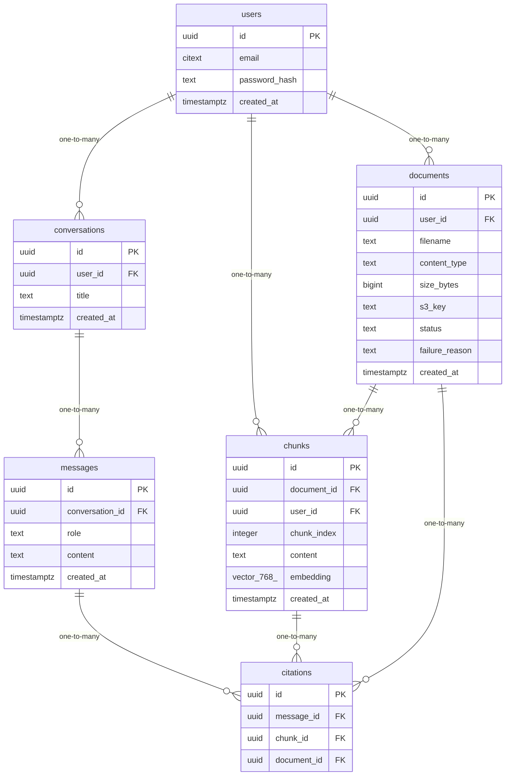

# Data Model

<!-- sdlc:auto:start entities -->
### users

| Field | Type | PK | FK | Nullable |
|---|---|---|---|---|
| id | uuid | True | — | False |
| email | citext | False | — | False |
| password_hash | text | False | — | False |
| created_at | timestamptz | False | — | False |

### documents

| Field | Type | PK | FK | Nullable |
|---|---|---|---|---|
| id | uuid | True | — | False |
| user_id | uuid | False | users.id | False |
| filename | text | False | — | False |
| content_type | text | False | — | False |
| size_bytes | bigint | False | — | False |
| s3_key | text | False | — | False |
| status | text | False | — | False |
| failure_reason | text | False | — | True |
| created_at | timestamptz | False | — | False |

### chunks

| Field | Type | PK | FK | Nullable |
|---|---|---|---|---|
| id | uuid | True | — | False |
| document_id | uuid | False | documents.id | False |
| user_id | uuid | False | users.id | False |
| chunk_index | integer | False | — | False |
| content | text | False | — | False |
| embedding | vector(768) | False | — | False |
| created_at | timestamptz | False | — | False |

### conversations

| Field | Type | PK | FK | Nullable |
|---|---|---|---|---|
| id | uuid | True | — | False |
| user_id | uuid | False | users.id | False |
| title | text | False | — | True |
| created_at | timestamptz | False | — | False |

### messages

| Field | Type | PK | FK | Nullable |
|---|---|---|---|---|
| id | uuid | True | — | False |
| conversation_id | uuid | False | conversations.id | False |
| role | text | False | — | False |
| content | text | False | — | False |
| created_at | timestamptz | False | — | False |

### citations

| Field | Type | PK | FK | Nullable |
|---|---|---|---|---|
| id | uuid | True | — | False |
| message_id | uuid | False | messages.id | False |
| chunk_id | uuid | False | chunks.id | False |
| document_id | uuid | False | documents.id | False |
<!-- sdlc:auto:end entities -->

<!-- sdlc:auto:start relationships -->
| Source | Target | Type |
|---|---|---|
| users | documents | one-to-many |
| users | chunks | one-to-many |
| users | conversations | one-to-many |
| documents | chunks | one-to-many |
| conversations | messages | one-to-many |
| messages | citations | one-to-many |
| chunks | citations | one-to-many |
| documents | citations | one-to-many |
<!-- sdlc:auto:end relationships -->

<!-- sdlc:auto:start er-diagram -->

<!-- sdlc:auto:end er-diagram -->
