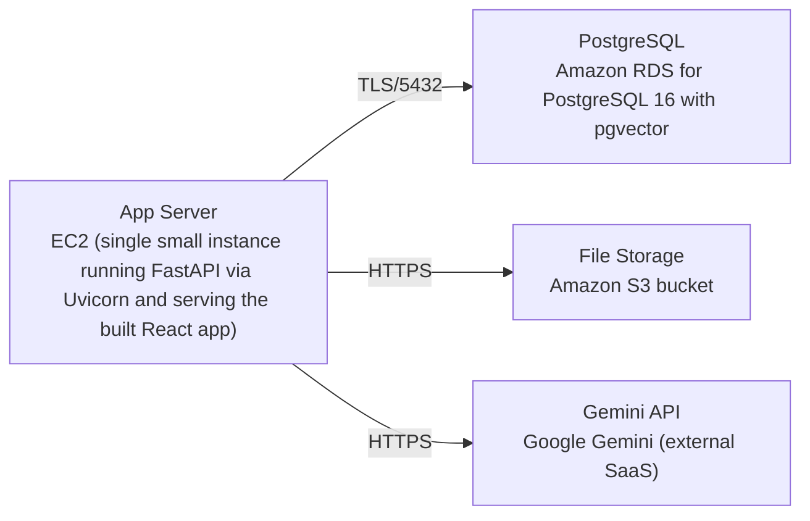

# Deployment Guide

> Maintained by QuorQ AI SDLC. Text between `sdlc:auto` markers is regenerated; anything outside them is yours and is kept.

<!-- sdlc:auto:start how-it-deploys -->
Pushes to `main` run `.github/workflows/deploy.yml`, which builds the API image (if there is a backend) and deploys the SPA to AWS Amplify. Commits touching only `docs/sdlc/**` don't deploy. Deployments can also be started from the platform's Deployment tab.
<!-- sdlc:auto:end how-it-deploys -->

<!-- sdlc:auto:start environments -->
| Name | Service | Runtime | Scaling | Environment |
|---|---|---|---|---|
| App Server | EC2 (single small instance running FastAPI via Uvicorn and serving the built React app) | Python 3.12 / Node build artifacts | single instance, vertical only (handful of users) | dev |
| PostgreSQL | Amazon RDS for PostgreSQL 16 with pgvector | PostgreSQL 16 | single instance | dev |
| File Storage | Amazon S3 bucket | managed | managed | dev |
| Gemini API | Google Gemini (external SaaS) | managed | managed | dev |
<!-- sdlc:auto:end environments -->

<!-- sdlc:auto:start live -->
**Frontend URL:** https://pe6412326af7c.d23m9gkl7erfkc.amplifyapp.com

**Backend URL:** https://52-32-239-66.sslip.io/apps/e6412326af7c/

**Database:** PostgreSQL · app

**Version:** c52fe36f29f3

**Commit:** `c52fe36`

**Finished:** 2026-10-27
<!-- sdlc:auto:end live -->

<!-- sdlc:auto:start topology -->

<!-- sdlc:auto:end topology -->
